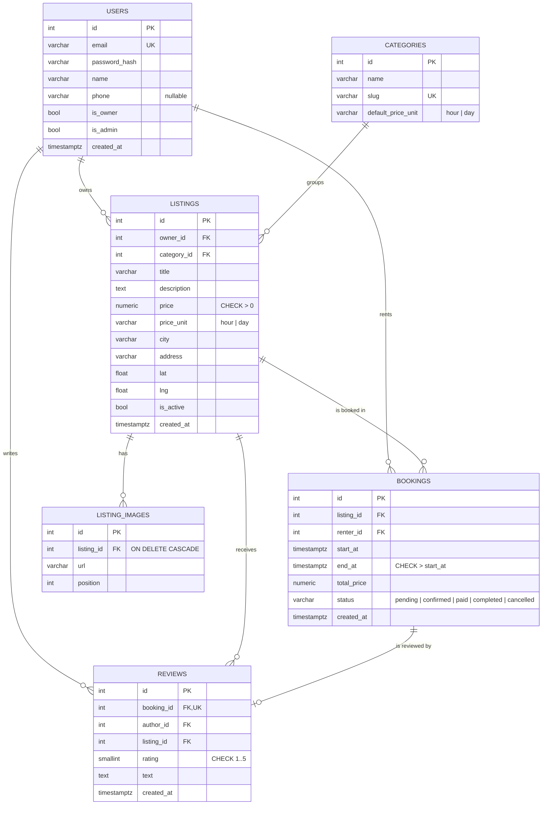

# Database

PostgreSQL 16. Models live in `app/models/`, and migrations in `migrations/versions/`.

## ER diagram



## Constraints

| Table | Constraint | Rule |
|---|---|---|
| users | `uq_users_email` | email is unique |
| categories | `uq_categories_slug` | slug is unique |
| categories | `ck_categories_default_price_unit_valid` | `default_price_unit IN ('hour', 'day')` |
| listings | `ck_listings_price_positive` | `price > 0` |
| listings | `ck_listings_price_unit_valid` | `price_unit IN ('hour', 'day')` |
| bookings | `ck_bookings_end_after_start` | `end_at > start_at` |
| bookings | `ck_bookings_status_valid` | status is one of the 5 allowed values |
| bookings | **`no_overlap`** | EXCLUDE: no two active bookings of the same listing overlap |
| reviews | `uq_reviews_booking_id` | one review per booking |
| reviews | `ck_reviews_rating_range` | `rating BETWEEN 1 AND 5` |

### `no_overlap`

```sql
CREATE EXTENSION IF NOT EXISTS btree_gist;

ALTER TABLE bookings ADD CONSTRAINT no_overlap
EXCLUDE USING gist (listing_id WITH =, tstzrange(start_at, end_at) WITH &&)
WHERE (status IN ('pending', 'confirmed', 'paid'));
```

- The guarantee lives in the database, so concurrent requests can't double-book even if the application check is skipped.
- Only **active** statuses (`pending`, `confirmed`, `paid`) block dates. A `cancelled` or `completed` booking does not.
- `tstzrange` is half-open `[start, end)`, so back-to-back bookings (one ends at 12:00, the next starts at 12:00) are allowed.
- It's created in its own migration (`c3d1f0a2b7e4_add_bookings_no_overlap.py`) because Alembic can't autogenerate EXCLUDE constraints.

## Seed data

`flask seed` loads demo data and is safe to run again, since it skips records that already exist:
- 5 categories: Машины, Велосипеды, Самокаты, Жильё, Площадки
- 5 users with password `password123`; `azamat@example.com` and `aigerim@example.com` are owners
- 20 listings in Bishkek with real addresses and coordinates, prices in KGS, 2 placeholder images each
